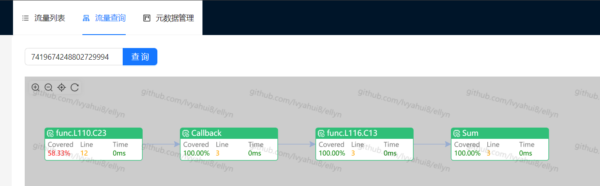
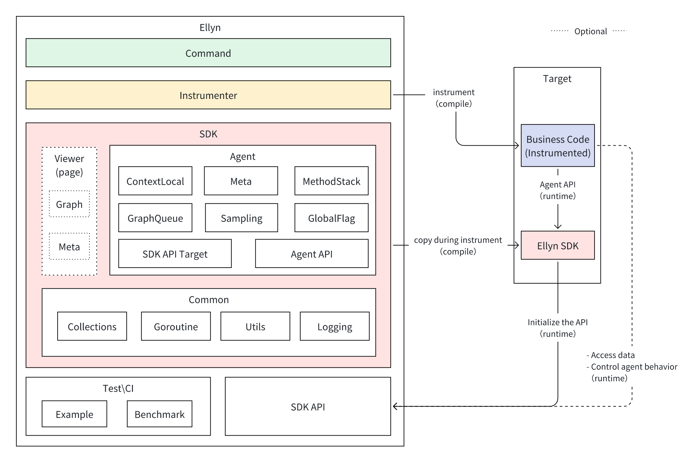
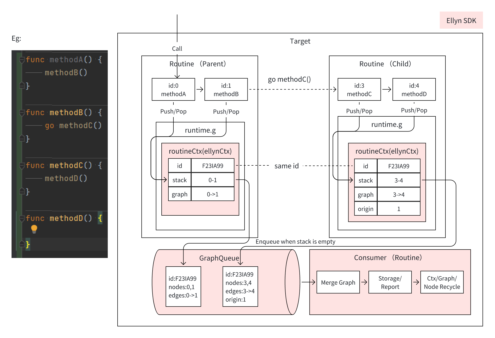

# Ellyn

A Go toolkit for coverage, call chains, and runtime data collection.

[](https://opensource.org/licenses/MIT)
[](https://goreportcard.com/report/github.com/lvyahui8/ellyn)
[](https://codecov.io/gh/lvyahui8/ellyn)

**Languages:** English | [简体中文](README.zh-CN.md)

Ellyn instruments Go applications to collect request-level coverage, function
call chains, asynchronous links, and runtime data such as arguments, return
values, exceptions, and latency. It is built for scenarios beyond coverage
statistics—observability, precision testing, traffic replay, and risk
analysis—where coverage alone is not enough.

## Features

- Global coverage collection for full and incremental coverage analysis.
- Function call chain collection, including asynchronous links.
- Runtime data collection covering arguments, return values, exceptions, and latency.
- Request-level collection of coverage, call chains, and runtime details.
- Concurrent collection.
- Core SDK components optimized for high-frequency runtime paths.
- Mock support is planned but not yet available.

## Use Cases

- Coverage statistics and coverage details for individual test cases.
- Call chain tracing and runtime observability.
- Data and field lineage analysis.
- Traffic observation and replay.
- Precision testing and automated testing.
- Risk analysis.
- Unified metrics, monitoring, and alerting.

## Requirements

- Go 1.18 or later.
- Linux, macOS, or Windows.

## Demo

Download the demo program for your platform from
[GitHub Releases](https://github.com/lvyahui8/ellyn/releases), run it, and open
[http://localhost:19898](http://localhost:19898).



## CLI Usage

Download the `ellyn` CLI from
[GitHub Releases](https://github.com/lvyahui8/ellyn/releases).

```text
NAME:
   ellyn - Go coverage and callgraph collection tool

USAGE:
   ellyn [global options] command [command options]

COMMANDS:
   update    update code
   rollback  rollback code
   help, h   Shows a list of commands or help for one command

GLOBAL OPTIONS:
   --help, -h  show help
```

Run the CLI from the directory containing the target Go application's `main`
package:

```shell
ellyn update
```

`ellyn update` instruments the project. Once instrumentation is complete,
rebuild and start the target service to begin collecting data.

```shell
ellyn rollback
```

`ellyn rollback` restores the original files and removes all traces of the
instrumentation.

## Repository Layout

- `api`: Runtime API for accessing the instrumented SDK.
- `benchmark`: Benchmarks that compare overhead across different scenarios and sampling rates.
- `cmd`: The `ellyn` command-line tool.
- `example`: Demo program for inspecting collected data.
- `instr`: Instrumentation logic that traverses target Go files and injects SDK calls.
- `sdk`: SDK code invoked by instrumented code; it is copied into the target project and compiled as part of it.
- `test`: Shared test helpers.
- `viewer`: Lightweight visualization UI.

## Architecture



## SDK Flow



## Development Notes

Because the SDK is copied into target projects, runtime code should minimize
dependencies and keep hot-path performance stable:

- Prefer lock-free designs to reduce resource conflicts and lock contention.
- Keep core operations at `O(1)`.
- Pad frequently accessed fields to cache-line boundaries to reduce false sharing.
- Trade space for time where the trade-off is justified.
- Prefer arrays and bitmaps over Go maps on hot paths.
- Reuse frequently allocated objects with `sync.Pool` to reduce GC pressure.
- When collecting parameters, be mindful of the performance cost of copying large values.

## SDK Components

- [RingBuffer](./sdk/common/collections/ringbuffer.go): Buffers call data.
  - [RingBuffer benchmarks](./sdk/common/collections/ringbuffer.md)
  - [RingBuffer vs. Map benchmark](./sdk/common/collections/ring_buffer_vs_map.md)
- [LinkedQueue](./sdk/common/collections/linked_queue.go): A linked-list-based synchronized queue used as the goroutine pool's task queue.
- [hmap / SegmentHashmap](./sdk/common/collections/hmap.go): A high-performance routine-local storage implementation.
  - [hmap benchmarks](./sdk/common/collections/hmap.md)
- [bitmap](./sdk/common/collections/bitmap.go): Records function and block execution.
- [UnsafeCompressedStack](./sdk/common/collections/stack.go): Emulates stack push and pop operations.
  - [Stack benchmarks](./sdk/common/collections/stack.md)
- [routineLocal / GLS / GoRoutineLocalStorage](./sdk/common/goroutine/routine_local.go): Caches goroutine context.
  - [routineLocal benchmarks](./sdk/common/goroutine/routine_local_test.go)
- [routinePool](./sdk/common/goroutine/routine_pool.go): A goroutine pool for concurrent file processing.
- [Uint64GUIDGenerator](./sdk/common/guid/guid.go): Generates call IDs.
- [AsyncLogger](./sdk/common/logging/readme.md): A high-performance asynchronous logger.

## Performance

- CPU-intensive workloads see measurable overhead, even at low sampling rates.
- I/O-intensive workloads are usually affected far less, even at higher sampling rates.

See [benchmark details](./benchmark/result.md).

## FAQ

### Why implement custom collection utilities instead of using open-source alternatives?

Some SDK code is copied into target repositories. Custom implementations avoid
dependency conflicts with those repositories while allowing Ellyn to optimize
for its own runtime collection paths. For code that is not copied into target
projects, reusing mature open-source implementations is still preferred.
